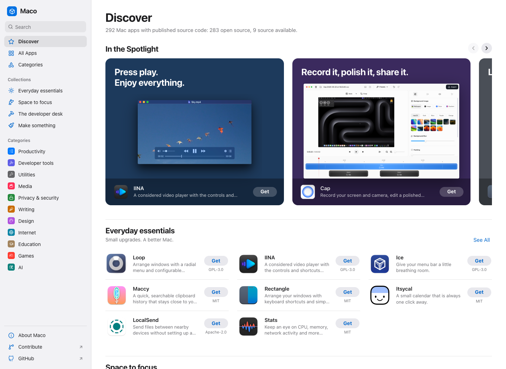

# Maco

**Good software. Open by nature.** A considered collection of open-source macOS apps and clearly labeled source-available alternatives, maintained by [Koative](https://github.com/koative).

[Explore the catalog](https://maco.koative.com/) · [Contribute an app](CONTRIBUTING.md) · [Research & inclusion policy](docs/RESEARCH.md)



Maco is an app-store-style catalog of open-source Mac software. Browse Discover shelves, collections, and categories, search the whole catalog, and open a product page that puts the source code, license, and official download side by side. Light and dark appearance follow your system. Every entry is a small, reviewable folder, and the website and the catalog below come from the same Markdown source.

## One app, one folder

```text
content/apps/
  rectangle/
    index.md              # Metadata + original Markdown description
    assets/
      icon.png            # Official image with recorded provenance
      screenshot.png
```

YAML frontmatter describes the app: name, summary, category, tags, repository, official website, download page, source classification, reviewed license, license evidence, verification date, and asset attribution. The Markdown body explains what it does. Screenshots are optional; invented screenshots and unverified compatibility claims are not accepted.

This structure keeps assets beside the app, makes pull requests understandable, and avoids one giant JSON file becoming a merge-conflict bottleneck. Generated output is never the editing surface.

## Development

Requires Bun 1.4.3+. Bun installs dependencies, runs TypeScript, executes tests, and runs Astro in development and CI. The static site is served by GitHub Pages.

```sh
bun install --frozen-lockfile
bun run dev
bun run validate
bun run check
bun test
bun run build
bun run check:links
```

Open the address printed by the dev server (normally `http://localhost:4321/`). `bun run sync` copies catalog assets for the site and refreshes the generated catalog below. CI checks the data, TypeScript, tests, and production build. Changes pushed to `main` deploy to GitHub Pages.

The [discovery queue](research/README.md) tracks repository leads from ten directories. Refresh it with `bun run discover`; only independently reviewed app folders enter the store.

See [publishing and SEO](docs/PUBLISHING.md) for the shared site configuration, social card, custom domain setup, and sitemap submission.

## Catalog principles

- **Licenses are explicit.** Paid open-source distributions can qualify. Apps with published source and additional restrictions are separately labeled **Source available**, explained on their detail pages, and filterable. Closed-source freeware is excluded.
- **Evidence travels with every entry.** Source repository, license file, official download, and a dated verification record are required.
- **Original projects get the credit.** Logos, screenshots, and trademarks belong to their respective owners; each included asset records its source and applicable rights.
- **A directory is a lead, not proof.** We research multiple lists and verify individual projects. See the [research notes](docs/RESEARCH.md).
- **No installer mirror.** Download links lead to official sources. Inclusion is not a security audit or an endorsement by Apple or the app authors.

## Browse the collection

<!-- catalog:start -->

292 macOS apps: **283 open source** and **9 source available**. Source-available apps have additional restrictions and are labeled separately. Generated from [content/apps](content/apps); edit the app folders to contribute.

### Productivity

| App | What it does | License |
| --- | --- | --- |
| [AeroSpace](https://maco.koative.com/apps/aerospace/) · [Source](https://github.com/nikitabobko/AeroSpace) | Arrange windows into keyboard-driven tiles and fast-switching workspaces. | [MIT](https://github.com/nikitabobko/AeroSpace/blob/main/LICENSE.txt) |
| [AltTab](https://maco.koative.com/apps/alttab/) · [Source](https://github.com/lwouis/alt-tab-macos) | Switch between individual windows with visual previews. | [GPL-3.0](https://github.com/lwouis/alt-tab-macos/blob/master/LICENCE.md) |
| [Amethyst](https://maco.koative.com/apps/amethyst/) · [Source](https://github.com/ianyh/Amethyst) | Automatically tile windows and move between layouts with keyboard shortcuts. | [MIT](https://github.com/ianyh/Amethyst/blob/development/LICENSE.md) |
| [AppFlowy](https://maco.koative.com/apps/appflowy/) · [Source](https://github.com/AppFlowy-IO/AppFlowy) | Arrange documents, tasks, and structured information in a customizable desktop workspace. | [AGPL-3.0](https://github.com/AppFlowy-IO/AppFlowy/blob/main/LICENSE) |
| [AutoRaise](https://maco.koative.com/apps/autoraise/) · [Source](https://github.com/sbmpost/AutoRaise) | Focus and raise windows automatically when you hover over them. | [GPL-3.0](https://github.com/sbmpost/AutoRaise/blob/master/LICENSE.md) |
| [BetterCmdTab](https://maco.koative.com/apps/bettercmdtab/) · [Source](https://github.com/rokartur/BetterCmdTab) | Switch among windows using searchable lists, grids, and live previews. | [GPL-3.0](https://github.com/rokartur/BetterCmdTab/blob/main/LICENSE) |
| [Calibre](https://maco.koative.com/apps/calibre/) · [Source](https://github.com/kovidgoyal/calibre) | Organize ebooks, edit their metadata, convert formats, and transfer books to reading devices. | [GPL-3.0](https://github.com/kovidgoyal/calibre/blob/master/LICENSE) |
| [Clipy](https://maco.koative.com/apps/clipy/) · [Source](https://github.com/Clipy/Clipy) | Recall clipboard history and reusable snippets through keyboard shortcuts. | [MIT](https://github.com/Clipy/Clipy/blob/develop/LICENSE) |
| [DockDoor](https://maco.koative.com/apps/dockdoor/) · [Source](https://github.com/ejbills/DockDoor) | Preview application windows from the Dock and switch between them quickly. | [GPL-3.0-or-later](https://github.com/ejbills/DockDoor/blob/main/LICENSE) |
| [Dorso](https://maco.koative.com/apps/dorso/) · [Source](https://github.com/tldev/dorso) | Use a screen-blur reminder based on camera or AirPods posture tracking. | [MIT](https://github.com/tldev/dorso/blob/main/LICENSE) |
| [EcoPaste](https://maco.koative.com/apps/ecopaste/) · [Source](https://github.com/EcoPasteHub/EcoPaste) | Store and search copied text, images, files, and folders locally. | [Apache-2.0](https://github.com/EcoPasteHub/EcoPaste/blob/master/LICENSE) |
| [Flycut](https://maco.koative.com/apps/flycut/) · [Source](https://github.com/TermiT/Flycut) | Keep a history of copied text and paste earlier items with a shortcut. | [MIT](https://github.com/TermiT/Flycut/blob/master/license.txt) |
| [Freeplane](https://maco.koative.com/apps/freeplane/) · [Source](https://github.com/freeplane/freeplane) | Map ideas into branching diagrams with notes, links, and structured project information. | [GPL-2.0](https://github.com/freeplane/freeplane/blob/1.13.x/license.txt) |
| [GnuCash](https://maco.koative.com/apps/gnucash/) · [Source](https://github.com/Gnucash/gnucash) | Track accounts, transactions, and reports with a desktop double-entry bookkeeping system. | [GPL-2.0-only OR GPL-3.0-only](https://github.com/Gnucash/gnucash/blob/stable/LICENSE) |
| [GoldenCheetah](https://maco.koative.com/apps/goldencheetah/) · [Source](https://github.com/GoldenCheetah/GoldenCheetah) | Analyze recorded endurance activities with charts, training histories, and performance metrics. | [GPL-2.0](https://github.com/GoldenCheetah/GoldenCheetah/blob/master/COPYING) |
| [Hammerspoon](https://maco.koative.com/apps/hammerspoon/) · [Source](https://github.com/Hammerspoon/hammerspoon) | Automate windows, shortcuts, and desktop behavior with Lua scripts. | [MIT](https://github.com/Hammerspoon/hammerspoon/blob/master/LICENSE) |
| [Itsycal](https://maco.koative.com/apps/itsycal/) · [Source](https://github.com/sfsam/Itsycal) | A small calendar that is always one click away. | [MIT](https://github.com/sfsam/Itsycal/blob/master/LICENSE.txt) |
| [Keyboard Cowboy](https://maco.koative.com/apps/keyboard-cowboy/) · [Source](https://github.com/zenangst/KeyboardCowboy) | Create keyboard workflows and context-sensitive automation for your Mac. | [MIT](https://github.com/zenangst/KeyboardCowboy/blob/main/LICENSE.md) |
| [Leader Key](https://maco.koative.com/apps/leader-key/) · [Source](https://github.com/mikker/LeaderKey) | Launch apps and actions through nested, memorable key sequences. | [MIT](https://github.com/mikker/LeaderKey/blob/main/LICENSE) |
| [LibreOffice](https://maco.koative.com/apps/libreoffice/) · [Source](https://github.com/LibreOffice/core) | Create documents, spreadsheets, presentations, and drawings in an open desktop office suite. | [MPL-2.0](https://github.com/LibreOffice/core/blob/master/COPYING.MPL) |
| [Loop](https://maco.koative.com/apps/loop/) · [Source](https://github.com/mrkai77/Loop) | Arrange windows with a radial menu and configurable keyboard shortcuts. | [GPL-3.0](https://github.com/mrkai77/Loop/blob/develop/LICENSE) |
| [Maccy](https://maco.koative.com/apps/maccy/) · [Source](https://github.com/p0deje/Maccy) | A quick, searchable clipboard history that stays close to your keyboard. | [MIT](https://github.com/p0deje/Maccy/blob/master/LICENSE) |
| [MeetingBar](https://maco.koative.com/apps/meetingbar/) · [Source](https://github.com/leits/MeetingBar) | Keep upcoming meetings in the menu bar and join from their calendar links. | [Apache-2.0](https://github.com/leits/MeetingBar/blob/master/LICENSE) |
| [Money Manager Ex](https://maco.koative.com/apps/money-manager-ex/) · [Source](https://github.com/moneymanagerex/moneymanagerex) | Track everyday spending, accounts, and budgets in a personal finance desktop application. | [GPL-2.0](https://github.com/moneymanagerex/moneymanagerex/blob/master/LICENSE) |
| [Notchprompt](https://maco.koative.com/apps/notchprompt/) · [Source](https://github.com/saif0200/notchprompt) | Scroll a script beside the notch while presenting or recording. | [MIT](https://github.com/saif0200/notchprompt/blob/main/LICENSE) |
| [NotchPrompter](https://maco.koative.com/apps/notch-prompter/) · [Source](https://github.com/jpomykala/NotchPrompter) | Keep a configurable floating script visible while presenting or recording. | [LicenseRef-NotchPrompter](https://github.com/jpomykala/NotchPrompter/blob/main/LICENSE) · **Source available** |
| [OmniWM](https://maco.koative.com/apps/omniwm/) · [Source](https://github.com/OmniNull/OmniWM) | Organize windows with scrolling containers or binary-tree tiling layouts. | [GPL-2.0](https://github.com/OmniNull/OmniWM/blob/main/LICENSE) |
| [ONLYOFFICE Desktop Editors](https://maco.koative.com/apps/onlyoffice/) · [Source](https://github.com/ONLYOFFICE/DesktopEditors) | Edit documents, spreadsheets, and presentations in a desktop office suite. | [AGPL-3.0](https://github.com/ONLYOFFICE/DesktopEditors/blob/master/LICENSE) |
| [PasteBar](https://maco.koative.com/apps/pastebar/) · [Source](https://github.com/PasteBar/PasteBarApp) | Organize copied content into searchable history, boards, and reusable collections. | [LicenseRef-PasteBar](https://github.com/PasteBar/PasteBarApp/blob/main/CC-LICENSE) · **Source available** |
| [Pasty](https://maco.koative.com/apps/pasty/) · [Source](https://github.com/IvyGain/Pasty) | Search clipboard history through a palette, a bottom strip, or a notch panel. | [MIT](https://github.com/IvyGain/Pasty/blob/main/LICENSE) |
| [Penc](https://maco.koative.com/apps/penc/) · [Source](https://github.com/dgurkaynak/Penc) | Move, resize, and snap windows with trackpad gestures. | [MIT](https://github.com/dgurkaynak/Penc/blob/master/LICENSE) |
| [Pesty](https://maco.koative.com/apps/pesty/) · [Source](https://github.com/momenbasel/pesty) | Browse clipboard history in a color-coded strip with reusable pinboards. | [MIT](https://github.com/momenbasel/pesty/blob/main/LICENSE) |
| [Quicksilver](https://maco.koative.com/apps/quicksilver/) · [Source](https://github.com/quicksilver/Quicksilver) | Launch applications and perform actions through a keyboard-driven interface. | [Apache-2.0](https://github.com/quicksilver/Quicksilver/blob/main/LICENSE) |
| [Rectangle](https://maco.koative.com/apps/rectangle/) · [Source](https://github.com/rxhanson/Rectangle) | Arrange your windows with keyboard shortcuts and simple edge snapping. | [MIT](https://github.com/rxhanson/Rectangle/blob/main/LICENSE) |
| [Reminders MenuBar](https://maco.koative.com/apps/reminders-menubar/) · [Source](https://github.com/DamascenoRafael/reminders-menubar) | View, create, and complete Apple Reminders from the menu bar. | [GPL-3.0](https://github.com/DamascenoRafael/reminders-menubar/blob/master/LICENSE) |
| [SaneClip](https://maco.koative.com/apps/saneclip/) · [Source](https://github.com/sane-apps/SaneClip) | Keep clipboard history with app exclusions and optional protection features. | [PolyForm-Shield-1.0.0](https://github.com/sane-apps/SaneClip/blob/main/LICENSE) · **Source available** |
| [ScreenHint](https://maco.koative.com/apps/screenhint/) · [Source](https://github.com/salemhilal/ScreenHint) | Keep captured screen regions visible as floating reference hints. | [GPL-3.0](https://github.com/salemhilal/ScreenHint/blob/main/LICENSE) |
| [SelfControl](https://maco.koative.com/apps/selfcontrol/) · [Source](https://github.com/SelfControlApp/selfcontrol) | Block distracting websites for a fixed period that cannot be canceled early. | [GPL-3.0](https://github.com/SelfControlApp/selfcontrol/blob/master/COPYING) |
| [SwiftShift](https://maco.koative.com/apps/swiftshift/) · [Source](https://github.com/pablopunk/SwiftShift) | Move and resize windows using configurable mouse and keyboard gestures. | [MIT](https://github.com/pablopunk/SwiftShift/blob/main/LICENSE) |
| [Switch](https://maco.koative.com/apps/switch/) · [Source](https://github.com/Sanyam-G/switch) | Navigate and filter open windows through a keyboard-driven switcher. | [FSL-1.1-MIT](https://github.com/Sanyam-G/switch/blob/main/LICENSE.md) · **Source available** |
| [Timer](https://maco.koative.com/apps/timer/) · [Source](https://github.com/michaelvillar/timer-app) | Set simple visual timers by dragging an arrow or typing a duration. | [MIT](https://github.com/michaelvillar/timer-app/blob/master/LICENSE) |
| [Tinycast](https://maco.koative.com/apps/tinycast/) · [Source](https://github.com/abue-ammar/tinycast) | Launch apps, search files, recall clipboard items, and run shortcuts from one palette. | [AGPL-3.0-or-later](https://github.com/abue-ammar/tinycast/blob/main/LICENSE) |
| [TomatoBar](https://maco.koative.com/apps/tomatobar/) · [Source](https://github.com/ivoronin/TomatoBar) | Run configurable work and break intervals from the menu bar. | [MIT](https://github.com/ivoronin/TomatoBar/blob/main/LICENSE) |
| [Übersicht](https://maco.koative.com/apps/uebersicht/) · [Source](https://github.com/felixhageloh/uebersicht) | Display customizable widgets directly on your desktop. | [GPL-3.0-or-later](https://github.com/felixhageloh/uebersicht/blob/master/LICENSE) |
| [Yippy](https://maco.koative.com/apps/yippy/) · [Source](https://github.com/mattDavo/Yippy) | Keep copied items in an accessible clipboard-history panel. | [MIT](https://github.com/mattDavo/Yippy/blob/master/LICENSE) |

### Developer tools

| App | What it does | License |
| --- | --- | --- |
| [Alacritty](https://maco.koative.com/apps/alacritty/) · [Source](https://github.com/alacritty/alacritty) | A GPU-accelerated terminal focused on a small, configurable core. | [Apache-2.0](https://github.com/alacritty/alacritty/blob/master/LICENSE-APACHE) |
| [Beekeeper Studio Community](https://maco.koative.com/apps/beekeeper-studio/) · [Source](https://github.com/beekeeper-studio/beekeeper-studio) | A SQL editor and database browser in the open-source Community edition. | [GPL-3.0-or-later](https://github.com/beekeeper-studio/beekeeper-studio/blob/master/LICENSE.md) |
| [Bruno](https://maco.koative.com/apps/bruno/) · [Source](https://github.com/usebruno/bruno) | Keep API collections in your project, alongside your code. | [MIT](https://github.com/usebruno/bruno/blob/main/license.md) |
| [CodeEdit](https://maco.koative.com/apps/codeedit/) · [Source](https://github.com/CodeEditApp/CodeEdit) | A community-built native Mac code editor with projects, terminal tools, and Git integration. | [MIT](https://github.com/CodeEditApp/CodeEdit/blob/main/LICENSE.md) |
| [DB Browser for SQLite](https://maco.koative.com/apps/db-browser-for-sqlite/) · [Source](https://github.com/sqlitebrowser/sqlitebrowser) | Browse SQLite files, edit tables, and run SQL through a desktop interface. | [MPL-2.0 OR GPL-3.0-or-later](https://github.com/sqlitebrowser/sqlitebrowser/blob/master/LICENSE) |
| [DBeaver Community](https://maco.koative.com/apps/dbeaver/) · [Source](https://github.com/dbeaver/dbeaver) | A database workbench for browsing tables, writing SQL, and managing many database engines. | [Apache-2.0](https://github.com/dbeaver/dbeaver/blob/devel/LICENSE.md) |
| [DbGate](https://maco.koative.com/apps/dbgate/) · [Source](https://github.com/dbgate/dbgate) | A database manager for querying SQL systems and exploring supported NoSQL stores. | [GPL-3.0](https://github.com/dbgate/dbgate/blob/master/LICENSE) |
| [DevToys](https://maco.koative.com/apps/devtoys/) · [Source](https://github.com/DevToys-app/DevToys) | A desktop collection of formatters, converters, encoders, and text utilities. | [MIT](https://github.com/DevToys-app/DevToys/blob/main/LICENSE.md) |
| [Geany](https://maco.koative.com/apps/geany/) · [Source](https://github.com/geany/geany) | A compact editor and IDE with syntax highlighting, project tools, and build commands. | [GPL-2.0](https://github.com/geany/geany/blob/master/COPYING) |
| [Ghostty](https://maco.koative.com/apps/ghostty/) · [Source](https://github.com/ghostty-org/ghostty) | A fast terminal with native Mac windows, tabs, split panes, and extensive keyboard controls. | [MIT](https://github.com/ghostty-org/ghostty/blob/main/LICENSE) |
| [GitButler](https://maco.koative.com/apps/gitbutler/) · [Source](https://github.com/gitbutlerapp/gitbutler) | A graphical Git workspace for organizing parallel changes and preparing commits. | [FSL-1.1-MIT](https://github.com/gitbutlerapp/gitbutler/blob/master/LICENSE.md) · **Source available** |
| [GitHub Desktop](https://maco.koative.com/apps/github-desktop/) · [Source](https://github.com/desktop/desktop) | A desktop Git workflow for reviewing diffs, committing changes, and working with branches. | [MIT](https://github.com/desktop/desktop/blob/development/LICENSE) |
| [Gittyup](https://maco.koative.com/apps/gittyup/) · [Source](https://github.com/Murmele/Gittyup) | A graphical Git client for reading history, inspecting changes, and preparing commits. | [MIT](https://github.com/Murmele/Gittyup/blob/master/LICENSE.md) |
| [GitUp](https://maco.koative.com/apps/gitup/) · [Source](https://github.com/git-up/GitUp) | A Mac Git client built around an interactive history graph and reversible operations. | [GPL-3.0](https://github.com/git-up/GitUp/blob/master/LICENSE) |
| [Hoppscotch Desktop](https://maco.koative.com/apps/hoppscotch/) · [Source](https://github.com/hoppscotch/hoppscotch) | The Hoppscotch API development workspace packaged as a desktop app. | [MIT](https://github.com/hoppscotch/hoppscotch/blob/main/LICENSE) |
| [Hyper](https://maco.koative.com/apps/hyper/) · [Source](https://github.com/vercel/hyper) | A terminal built with web technologies and customized through themes and extensions. | [MIT](https://github.com/vercel/hyper/blob/canary/LICENSE) |
| [Insomnia](https://maco.koative.com/apps/insomnia/) · [Source](https://github.com/Kong/insomnia) | Design and send API requests, inspect responses, and organize collections of endpoints. | [Apache-2.0](https://github.com/Kong/insomnia/blob/develop/LICENSE) |
| [iTerm2](https://maco.koative.com/apps/iterm2/) · [Source](https://github.com/gnachman/iTerm2) | A Mac terminal with split panes, search, profiles, and deep shell integration. | [GPL-2.0](https://github.com/gnachman/iTerm2/blob/master/LICENSE) |
| [kitty](https://maco.koative.com/apps/kitty/) · [Source](https://github.com/kovidgoyal/kitty) | A keyboard-driven terminal with GPU rendering, layouts, and extensible helper tools. | [GPL-3.0](https://github.com/kovidgoyal/kitty/blob/master/LICENSE) |
| [Lapce](https://maco.koative.com/apps/lapce/) · [Source](https://github.com/lapce/lapce) | A code editor built around responsive editing, language tools, and a modern interface. | [Apache-2.0](https://github.com/lapce/lapce/blob/master/LICENSE) |
| [Lite XL](https://maco.koative.com/apps/lite-xl/) · [Source](https://github.com/lite-xl/lite-xl) | A lightweight text editor extended with Lua plugins and a deliberately compact interface. | [MIT](https://github.com/lite-xl/lite-xl/blob/master/LICENSE) |
| [MacVim](https://maco.koative.com/apps/macvim/) · [Source](https://github.com/macvim-dev/macvim) | Vim editing in a Mac desktop app with platform integration and graphical windows. | [Vim](https://github.com/macvim-dev/macvim/blob/master/LICENSE) |
| [Medis](https://maco.koative.com/apps/medis/) · [Source](https://github.com/luin/medis) | A graphical Redis client for browsing keys and inspecting stored values. | [MIT](https://github.com/luin/medis/blob/master/LICENSE) |
| [pgAdmin 4](https://maco.koative.com/apps/pgadmin/) · [Source](https://github.com/pgadmin-org/pgadmin4) | A PostgreSQL administration app with database navigation, query tools, and server management. | [PostgreSQL](https://github.com/pgadmin-org/pgadmin4/blob/master/LICENSE) |
| [Podman Desktop](https://maco.koative.com/apps/podman-desktop/) · [Source](https://github.com/podman-desktop/podman-desktop) | Manage containers, images, and local development environments from a desktop app. | [Apache-2.0](https://github.com/podman-desktop/podman-desktop/blob/main/LICENSE) |
| [Pulsar](https://maco.koative.com/apps/pulsar/) · [Source](https://github.com/pulsar-edit/pulsar) | A community-led text and code editor continuing the extensible Atom experience. | [MIT](https://github.com/pulsar-edit/pulsar/blob/master/LICENSE.md) |
| [Rancher Desktop](https://maco.koative.com/apps/rancher-desktop/) · [Source](https://github.com/rancher-sandbox/rancher-desktop) | A local container and Kubernetes environment with desktop settings and management tools. | [Apache-2.0](https://github.com/rancher-sandbox/rancher-desktop/blob/main/LICENSE) |
| [Rio](https://maco.koative.com/apps/rio/) · [Source](https://github.com/raphamorim/rio) | A hardware-accelerated terminal with configurable rendering and window layouts. | [MIT](https://github.com/raphamorim/rio/blob/main/LICENSE) |
| [Sequel Ace](https://maco.koative.com/apps/sequel-ace/) · [Source](https://github.com/Sequel-Ace/Sequel-Ace) | Explore MySQL and MariaDB databases in a native Mac interface. | [MIT](https://github.com/Sequel-Ace/Sequel-Ace/blob/main/LICENSE) |
| [Tabby](https://maco.koative.com/apps/tabby/) · [Source](https://github.com/Eugeny/tabby) | A terminal workspace for local shells, SSH connections, and serial devices. | [MIT](https://github.com/Eugeny/tabby/blob/master/LICENSE) |
| [TextMate](https://maco.koative.com/apps/textmate/) · [Source](https://github.com/textmate/textmate) | A Mac text editor with language bundles, snippets, commands, and project navigation. | [GPL-3.0-or-later](https://github.com/textmate/textmate/blob/master/LICENSE) |
| [UTM](https://maco.koative.com/apps/utm/) · [Source](https://github.com/utmapp/UTM) | Run virtual machines and emulate other systems through a Mac desktop interface. | [Apache-2.0](https://github.com/utmapp/UTM/blob/main/LICENSE) |
| [VSCodium](https://maco.koative.com/apps/vscodium/) · [Source](https://github.com/VSCodium/vscodium) | Community builds of the VS Code source with a different default distribution setup. | [MIT](https://github.com/VSCodium/vscodium/blob/master/LICENSE) |
| [WezTerm](https://maco.koative.com/apps/wezterm/) · [Source](https://github.com/wezterm/wezterm) | A configurable terminal and multiplexer with tabs, panes, and Lua-based settings. | [MIT](https://github.com/wezterm/wezterm/blob/main/LICENSE.md) |
| [Wireshark](https://maco.koative.com/apps/wireshark/) · [Source](https://github.com/wireshark/wireshark) | Capture and inspect network traffic with protocol-aware views and powerful display filters. | [GPL-2.0](https://github.com/wireshark/wireshark/blob/master/COPYING) |
| [Yaak](https://maco.koative.com/apps/yaak/) · [Source](https://github.com/mountain-loop/yaak) | A desktop API client for organizing requests and examining responses. | [MIT](https://github.com/mountain-loop/yaak/blob/main/LICENSE) |
| [Zed](https://maco.koative.com/apps/zed/) · [Source](https://github.com/zed-industries/zed) | A fast code editor with project navigation, collaboration, and integrated development tools. | [GPL-3.0-or-later AND Apache-2.0](https://github.com/zed-industries/zed/blob/main/LICENSE-GPL) |

### Utilities

| App | What it does | License |
| --- | --- | --- |
| [AppPolice](https://maco.koative.com/apps/apppolice/) · [Source](https://github.com/AppPolice/AppPolice) | Limit the CPU usage of a selected running process. | [GPL-2.0](https://github.com/AppPolice/AppPolice/blob/master/LICENSE) |
| [AppPorts](https://maco.koative.com/apps/appports/) · [Source](https://github.com/wzh4869/AppPorts) | Move suitable applications and their data to external storage. | [Apache-2.0](https://github.com/wzh4869/AppPorts/blob/main/LICENSE) |
| [Atoll](https://maco.koative.com/apps/atoll/) · [Source](https://github.com/Ebullioscopic/Atoll) | Bring media controls, timers, and system information to the MacBook notch. | [GPL-3.0](https://github.com/Ebullioscopic/Atoll/blob/dev/LICENSE) |
| [Background Music](https://maco.koative.com/apps/background-music/) · [Source](https://github.com/kyleneideck/BackgroundMusic) | Control application volumes and pause music when another app plays audio. | [GPL-2.0](https://github.com/kyleneideck/BackgroundMusic/blob/master/LICENSE) |
| [Bitcoin Core](https://maco.koative.com/apps/bitcoin-core/) · [Source](https://github.com/bitcoin/bitcoin) | A Bitcoin node and wallet application with a graphical desktop interface. | [MIT](https://github.com/bitcoin/bitcoin/blob/master/COPYING) |
| [Boring Notch](https://maco.koative.com/apps/boring-notch/) · [Source](https://github.com/TheBoredTeam/boring.notch) | Expand the notch into media controls, calendar information, and a file shelf. | [GPL-3.0](https://github.com/TheBoredTeam/boring.notch/blob/main/LICENSE) |
| [Dozer](https://maco.koative.com/apps/dozer/) · [Source](https://github.com/Mortennn/Dozer) | Hide groups of menu bar icons until you need them. | [MPL-2.0](https://github.com/Mortennn/Dozer/blob/master/LICENSE) |
| [DropPoint](https://maco.koative.com/apps/droppoint/) · [Source](https://github.com/GameGodS3/DropPoint) | Use a temporary shelf to move files between windows and desktops. | [GPL-3.0](https://github.com/GameGodS3/DropPoint/blob/main/LICENSE) |
| [Electrum](https://maco.koative.com/apps/electrum/) · [Source](https://github.com/spesmilo/electrum) | A Bitcoin wallet with a desktop interface and support for advanced wallet workflows. | [MIT](https://github.com/spesmilo/electrum/blob/master/LICENCE) |
| [eul](https://maco.koative.com/apps/eul/) · [Source](https://github.com/gao-sun/eul) | Monitor Mac resource usage and device information from the menu bar. | [MIT](https://github.com/gao-sun/eul/blob/master/LICENSE) |
| [Finicky](https://maco.koative.com/apps/finicky/) · [Source](https://github.com/johnste/finicky) | Route links to different browsers with configurable rules. | [MIT](https://github.com/johnste/finicky/blob/main/LICENSE) |
| [Hidden Bar](https://maco.koative.com/apps/hidden-bar/) · [Source](https://github.com/dwarvesf/hidden) | Hide the menu bar items you rarely need, with a single divider. | [MIT](https://github.com/dwarvesf/hidden/blob/develop/LICENSE) |
| [Hot](https://maco.koative.com/apps/hot/) · [Source](https://github.com/macmade/Hot) | See CPU temperature and thermal pressure from the menu bar. | [MIT](https://github.com/macmade/Hot/blob/main/LICENSE) |
| [HotkeyClash](https://maco.koative.com/apps/hotkeyclash/) · [Source](https://github.com/Wunderlandmedia/HotkeyClash) | Find conflicting shortcuts across running apps and common automation tools. | [GPL-2.0](https://github.com/Wunderlandmedia/HotkeyClash/blob/main/LICENSE) |
| [Ice](https://maco.koative.com/apps/ice/) · [Source](https://github.com/jordanbaird/Ice) | Give your menu bar a little breathing room. | [GPL-3.0](https://github.com/jordanbaird/Ice/blob/main/LICENSE) |
| [Input Source Pro](https://maco.koative.com/apps/input-source-pro/) · [Source](https://github.com/runjuu/InputSourcePro) | Switch keyboard input sources automatically for different apps and websites. | [GPL-3.0](https://github.com/runjuu/InputSourcePro/blob/main/LICENSE) |
| [Karabiner-Elements](https://maco.koative.com/apps/karabiner-elements/) · [Source](https://github.com/pqrs-org/Karabiner-Elements) | Remap keys and build complex keyboard rules for macOS. | [Unlicense](https://github.com/pqrs-org/Karabiner-Elements/blob/main/LICENSE.md) |
| [KeepingYouAwake](https://maco.koative.com/apps/keepingyouawake/) · [Source](https://github.com/newmarcel/KeepingYouAwake) | Keep your Mac awake for a chosen interval from the menu bar. | [MIT](https://github.com/newmarcel/KeepingYouAwake/blob/main/LICENSE) |
| [KeyCastr](https://maco.koative.com/apps/keycastr/) · [Source](https://github.com/keycastr/keycastr) | Display keystrokes and mouse clicks during demos and recordings. | [BSD-3-Clause](https://github.com/keycastr/keycastr/blob/main/LICENSE.md) |
| [Latest](https://maco.koative.com/apps/latest/) · [Source](https://github.com/mangerlahn/Latest) | See available updates for supported Mac apps in one place. | [GPL-3.0](https://github.com/mangerlahn/Latest/blob/main/LICENSE.md) |
| [LinearMouse](https://maco.koative.com/apps/linearmouse/) · [Source](https://github.com/linearmouse/linearmouse) | Tune mouse and trackpad behavior with controls for scrolling and pointer movement. | [MIT](https://github.com/linearmouse/linearmouse/blob/main/LICENSE) |
| [LocalSend](https://maco.koative.com/apps/localsend/) · [Source](https://github.com/localsend/localsend) | Send files between nearby devices without setting up a cloud account. | [Apache-2.0](https://github.com/localsend/localsend/blob/main/LICENSE) |
| [LockIME](https://maco.koative.com/apps/lockime/) · [Source](https://github.com/oomol-lab/LockIME) | Lock or switch your input source globally, by application, or by website. | [GPL-3.0](https://github.com/oomol-lab/LockIME/blob/main/LICENSE) |
| [Lunar](https://maco.koative.com/apps/lunar/) · [Source](https://github.com/alin23/Lunar) | Control external monitor brightness, volume, and input settings. | [MIT](https://github.com/alin23/Lunar/blob/master/LICENSE) |
| [Mac Mouse Fix](https://maco.koative.com/apps/mac-mouse-fix/) · [Source](https://github.com/noah-nuebling/mac-mouse-fix) | Customize mouse buttons, scrolling, and gestures for everyday navigation on macOS. | [LicenseRef-Mac-Mouse-Fix](https://github.com/noah-nuebling/mac-mouse-fix/blob/master/License) · **Source available** |
| [MacPacker](https://maco.koative.com/apps/macpacker/) · [Source](https://github.com/sarensw/MacPacker) | Browse archives and extract selected files without unpacking everything. | [GPL-3.0](https://github.com/sarensw/MacPacker/blob/main/LICENSE) |
| [MenuMeters](https://maco.koative.com/apps/menumeters/) · [Source](https://github.com/yujitach/MenuMeters) | Show CPU, memory, disk, and network activity in the menu bar. | [GPL-2.0](https://github.com/yujitach/MenuMeters/blob/main/LICENSE) |
| [MiddleClick](https://maco.koative.com/apps/middleclick/) · [Source](https://github.com/artginzburg/MiddleClick) | Add a middle-click gesture to a Mac trackpad or Magic Mouse. | [GPL-3.0](https://github.com/artginzburg/MiddleClick/blob/main/LICENSE) |
| [MiddleDrag](https://maco.koative.com/apps/middledrag/) · [Source](https://github.com/NullPointerDepressiveDisorder/MiddleDrag) | Add middle-click and middle-drag gestures to the Mac trackpad. | [MIT](https://github.com/NullPointerDepressiveDisorder/MiddleDrag/blob/main/LICENSE) |
| [MonitorControl](https://maco.koative.com/apps/monitorcontrol/) · [Source](https://github.com/MonitorControl/MonitorControl) | Adjust supported external displays using familiar Mac controls. | [MIT](https://github.com/MonitorControl/MonitorControl/blob/main/License.txt) |
| [Monolingual](https://maco.koative.com/apps/monolingual/) · [Source](https://github.com/IngmarStein/Monolingual) | Remove language resources you do not need from installed software. | [GPL-3.0](https://github.com/IngmarStein/Monolingual/blob/main/LICENSE.txt) |
| [Mos](https://maco.koative.com/apps/mos/) · [Source](https://github.com/Caldis/Mos) | Smooth out mouse-wheel scrolling and set its direction independently of the trackpad. | [CC-BY-NC-4.0](https://github.com/Caldis/Mos/blob/master/LICENSE) · **Source available** |
| [MountMate](https://maco.koative.com/apps/mountmate/) · [Source](https://github.com/homielab/mountmate) | Mount and unmount external drives and reconnect network shares from the menu bar. | [MIT](https://github.com/homielab/mountmate/blob/main/LICENSE) |
| [NAPS2](https://maco.koative.com/apps/naps2/) · [Source](https://github.com/cyanfish/naps2) | Scan documents, arrange pages, and create searchable PDFs with a focused desktop scanning app. | [GPL-2.0-or-later](https://github.com/cyanfish/naps2/blob/master/LICENSE) |
| [NearDrop](https://maco.koative.com/apps/neardrop/) · [Source](https://github.com/grishka/NearDrop) | Exchange files with Android Quick Share devices on the same network. | [Unlicense](https://github.com/grishka/NearDrop/blob/master/UNLICENSE) |
| [Neodisk](https://maco.koative.com/apps/neodisk/) · [Source](https://github.com/tkslucas/Neodisk) | Explore disk usage through interactive treemap and sunburst views. | [GPL-3.0](https://github.com/tkslucas/Neodisk/blob/main/LICENSE) |
| [NeoHtop](https://maco.koative.com/apps/neohtop/) · [Source](https://github.com/Abdenasser/neohtop) | Inspect process activity with searchable CPU and memory views. | [MIT](https://github.com/Abdenasser/neohtop/blob/main/LICENSE) |
| [NotchDrop](https://maco.koative.com/apps/notchdrop/) · [Source](https://github.com/Lakr233/NotchDrop) | Use the MacBook notch as a temporary file shelf and AirDrop shortcut. | [MIT](https://github.com/Lakr233/NotchDrop/blob/main/LICENSE) |
| [noTunes](https://maco.koative.com/apps/notunes/) · [Source](https://github.com/tombonez/noTunes) | Prevent unwanted Apple Music launches and optionally open another app instead. | [MIT](https://github.com/tombonez/noTunes/blob/master/LICENSE) |
| [OnlySwitch](https://maco.koative.com/apps/onlyswitch/) · [Source](https://github.com/jacklandrin/OnlySwitch) | Collect everyday macOS toggles and shortcuts into a configurable menu. | [MIT](https://github.com/jacklandrin/OnlySwitch/blob/main/LICENSE) |
| [PDFsam Basic](https://maco.koative.com/apps/pdfsam/) · [Source](https://github.com/torakiki/pdfsam) | Split, merge, rotate, and reorganize PDF documents with a desktop toolkit. | [AGPL-3.0](https://github.com/torakiki/pdfsam/blob/master/LICENSE) |
| [Pearcleaner](https://maco.koative.com/apps/pearcleaner/) · [Source](https://github.com/alienator88/Pearcleaner) | Inspect installed apps and their leftover files before removing them from your Mac. | [Apache-2.0 WITH Commons-Clause](https://github.com/alienator88/Pearcleaner/blob/main/LICENSE.md) · **Source available** |
| [PureMac](https://maco.koative.com/apps/puremac/) · [Source](https://github.com/momenbasel/PureMac) | Review cache cleanup, installed apps, and storage usage in a native Mac interface. | [MIT](https://github.com/momenbasel/PureMac/blob/main/LICENSE) |
| [QLMarkdown](https://maco.koative.com/apps/qlmarkdown/) · [Source](https://github.com/sbarex/QLMarkdown) | Preview formatted Markdown through Finder's Quick Look. | [GPL-3.0](https://github.com/sbarex/QLMarkdown/blob/main/LICENSE.txt) |
| [RsyncUI](https://maco.koative.com/apps/rsyncui/) · [Source](https://github.com/rsyncOSX/RsyncUI) | Configure and organize rsync transfers through a macOS interface. | [MIT](https://github.com/rsyncOSX/RsyncUI/blob/main/Licence.MD) |
| [RustDesk](https://maco.koative.com/apps/rustdesk/) · [Source](https://github.com/rustdesk/rustdesk) | A remote desktop application with an option to use your own connection infrastructure. | [AGPL-3.0](https://github.com/rustdesk/rustdesk/blob/master/LICENCE) |
| [Scroll Reverser](https://maco.koative.com/apps/scroll-reverser/) · [Source](https://github.com/pilotmoon/Scroll-Reverser) | Choose scrolling direction separately for different input devices. | [Apache-2.0](https://github.com/pilotmoon/Scroll-Reverser/blob/master/LICENSE) |
| [SensibleSideButtons](https://maco.koative.com/apps/sensible-side-buttons/) · [Source](https://github.com/archagon/sensible-side-buttons) | Use extra mouse buttons for back and forward navigation across macOS. | [GPL-2.0](https://github.com/archagon/sensible-side-buttons/blob/master/LICENSE) |
| [Shifty](https://maco.koative.com/apps/shifty/) · [Source](https://github.com/thompsonate/Shifty) | Adjust Night Shift quickly and create app-specific exceptions. | [GPL-3.0](https://github.com/thompsonate/Shifty/blob/master/LICENSE) |
| [SlimHUD](https://maco.koative.com/apps/slimhud/) · [Source](https://github.com/AlexPerathoner/SlimHUD) | Replace volume and brightness overlays with configurable slim indicators. | [GPL-3.0](https://github.com/AlexPerathoner/SlimHUD/blob/develop/LICENSE.md) |
| [Sparrow Wallet](https://maco.koative.com/apps/sparrow/) · [Source](https://github.com/sparrowwallet/sparrow) | A desktop Bitcoin wallet with detailed transaction views and hardware wallet support. | [Apache-2.0](https://github.com/sparrowwallet/sparrow/blob/master/LICENSE) |
| [Stats](https://maco.koative.com/apps/stats/) · [Source](https://github.com/exelban/stats) | Keep an eye on CPU, memory, network activity and more from your menu bar. | [MIT](https://github.com/exelban/stats/blob/master/LICENSE) |
| [SwiftBar](https://maco.koative.com/apps/swiftbar/) · [Source](https://github.com/swiftbar/SwiftBar) | Build menu bar tools from scripts and a library of community plugins. | [MIT](https://github.com/swiftbar/SwiftBar/blob/main/LICENSE) |
| [Syncthing for macOS](https://maco.koative.com/apps/syncthing-macos/) · [Source](https://github.com/syncthing/syncthing-macos) | A Mac app wrapper that starts and manages the Syncthing file synchronization service. | [MIT](https://github.com/syncthing/syncthing-macos/blob/v2/LICENSE) |
| [Syntax Highlight](https://maco.koative.com/apps/syntax-highlight/) · [Source](https://github.com/sbarex/SourceCodeSyntaxHighlight) | Read source files with syntax highlighting in Finder Quick Look. | [GPL-3.0](https://github.com/sbarex/SourceCodeSyntaxHighlight/blob/master/LICENSE.txt) |
| [Thaw](https://maco.koative.com/apps/thaw/) · [Source](https://github.com/thaw-app/Thaw) | Organize, search, and reveal menu bar items with contextual layouts. | [GPL-3.0](https://github.com/thaw-app/Thaw/blob/development/LICENSE) |
| [TRex](https://maco.koative.com/apps/trex/) · [Source](https://github.com/amebalabs/TRex) | Capture text from the screen with local optical character recognition. | [MIT](https://github.com/amebalabs/TRex/blob/main/LICENSE) |
| [UnnaturalScrollWheels](https://maco.koative.com/apps/unnatural-scroll-wheels/) · [Source](https://github.com/ther0n/UnnaturalScrollWheels) | Reverse a physical mouse wheel without changing natural trackpad scrolling. | [GPL-3.0](https://github.com/ther0n/UnnaturalScrollWheels/blob/main/LICENSE) |
| [xbar](https://maco.koative.com/apps/xbar/) · [Source](https://github.com/matryer/xbar) | Put script output and custom controls in your macOS menu bar. | [MIT](https://github.com/matryer/xbar/blob/main/LICENSE.txt) |

### Media

| App | What it does | License |
| --- | --- | --- |
| [Audacity](https://maco.koative.com/apps/audacity/) · [Source](https://github.com/audacity/audacity) | Record, trim, mix, and process audio in a multitrack desktop editor. | [GPL-3.0-only](https://github.com/audacity/audacity/blob/master/LICENSE.txt) |
| [Cap](https://maco.koative.com/apps/cap/) · [Source](https://github.com/CapSoftware/Cap) | Record your screen and camera, edit a polished video, and share it from your own workflow. | [AGPL-3.0](https://github.com/CapSoftware/Cap/blob/main/LICENSE) |
| [Clementine](https://maco.koative.com/apps/clementine/) · [Source](https://github.com/clementine-player/Clementine) | Browse a music library, manage playlists, and listen to local tracks or internet radio. | [GPL-3.0](https://github.com/clementine-player/Clementine/blob/master/COPYING) |
| [FreeTube](https://maco.koative.com/apps/freetube/) · [Source](https://github.com/FreeTubeApp/FreeTube) | Watch YouTube through a desktop client with local subscriptions and viewing preferences. | [AGPL-3.0](https://github.com/FreeTubeApp/FreeTube/blob/development/LICENSE) |
| [Gifski](https://maco.koative.com/apps/gifski/) · [Source](https://github.com/sindresorhus/Gifski) | Turn video clips into animated GIFs with controls for size, quality, and playback. | [MIT](https://github.com/sindresorhus/Gifski/blob/main/license) |
| [HandBrake](https://maco.koative.com/apps/handbrake/) · [Source](https://github.com/HandBrake/HandBrake) | Convert video files with useful presets and detailed encoding controls. | [GPL-2.0-only](https://github.com/HandBrake/HandBrake/blob/master/LICENSE) |
| [Hydrogen](https://maco.koative.com/apps/hydrogen/) · [Source](https://github.com/hydrogen-music/hydrogen) | Program drum patterns and arrange them into songs with a dedicated drum machine. | [GPL-2.0](https://github.com/hydrogen-music/hydrogen/blob/main/COPYING) |
| [IINA](https://maco.koative.com/apps/iina/) · [Source](https://github.com/iina/iina) | A considered video player with the controls and shortcuts Mac users expect. | [GPL-3.0](https://github.com/iina/iina/blob/develop/LICENSE) |
| [ImageOptim](https://maco.koative.com/apps/imageoptim/) · [Source](https://github.com/ImageOptim/ImageOptim) | Reduce image file sizes through a desktop interface for established optimizers. | [GPL-2.0-or-later](https://github.com/ImageOptim/ImageOptim/blob/main/LICENSE) |
| [Jellyfin Desktop](https://maco.koative.com/apps/jellyfin-desktop/) · [Source](https://github.com/jellyfin/jellyfin-desktop) | A desktop client for browsing and playing media from a Jellyfin server. | [GPL-2.0](https://github.com/jellyfin/jellyfin-desktop/blob/master/LICENSE) |
| [Kap](https://maco.koative.com/apps/kap/) · [Source](https://github.com/wulkano/Kap) | Capture a small moment on your screen and share it as a clip. | [MIT](https://github.com/wulkano/Kap/blob/main/LICENSE.md) |
| [Kdenlive](https://maco.koative.com/apps/kdenlive/) · [Source](https://github.com/KDE/kdenlive) | Edit multitrack video with effects, transitions, proxy workflows, and flexible export options. | [GPL-3.0](https://github.com/KDE/kdenlive/blob/master/COPYING) |
| [LMMS](https://maco.koative.com/apps/lmms/) · [Source](https://github.com/LMMS/lmms) | Compose electronic music with a piano roll, instruments, patterns, and an effects mixer. | [GPL-2.0](https://github.com/LMMS/lmms/blob/master/LICENSE.txt) |
| [LosslessCut](https://maco.koative.com/apps/losslesscut/) · [Source](https://github.com/mifi/lossless-cut) | Trim and rearrange video or audio segments without re-encoding supported media. | [GPL-2.0](https://github.com/mifi/lossless-cut/blob/master/LICENSE) |
| [Mixxx](https://maco.koative.com/apps/mixxx/) · [Source](https://github.com/mixxxdj/mixxx) | Mix music with virtual decks, beat analysis, effects, and support for DJ controllers. | [GPL-2.0-or-later](https://github.com/mixxxdj/mixxx/blob/main/LICENSE) |
| [MuseScore Studio](https://maco.koative.com/apps/musescore/) · [Source](https://github.com/musescore/MuseScore) | Compose, arrange, and print sheet music with a dedicated notation editor. | [GPL-3.0-only](https://github.com/musescore/MuseScore/blob/main/LICENSE.txt) |
| [MusicBrainz Picard](https://maco.koative.com/apps/musicbrainz-picard/) · [Source](https://github.com/metabrainz/picard) | Match albums to MusicBrainz and clean up the tags in a local music collection. | [GPL-2.0](https://github.com/metabrainz/picard/blob/master/COPYING.txt) |
| [Natron](https://maco.koative.com/apps/natron/) · [Source](https://github.com/NatronGitHub/Natron) | Build visual effects and image composites by connecting processing nodes. | [GPL-2.0](https://github.com/NatronGitHub/Natron/blob/RB-2.6/LICENSE.txt) |
| [Nuclear](https://maco.koative.com/apps/nuclear/) · [Source](https://github.com/nukeop/nuclear) | Discover and play music through a desktop player that brings multiple online sources together. | [AGPL-3.0](https://github.com/nukeop/nuclear/blob/master/LICENSE) |
| [OBS Studio](https://maco.koative.com/apps/obs-studio/) · [Source](https://github.com/obsproject/obs-studio) | Build scenes, record your screen and broadcast live. | [GPL-2.0](https://github.com/obsproject/obs-studio/blob/master/COPYING) |
| [OpenShot](https://maco.koative.com/apps/openshot/) · [Source](https://github.com/OpenShot/openshot-qt) | Assemble clips, titles, transitions, and audio in an approachable timeline video editor. | [GPL-3.0](https://github.com/OpenShot/openshot-qt/blob/develop/COPYING) |
| [QuickRecorder](https://maco.koative.com/apps/quickrecorder/) · [Source](https://github.com/lihaoyun6/QuickRecorder) | Record screens, windows, and apps with audio and presenter controls. | [AGPL-3.0](https://github.com/lihaoyun6/QuickRecorder/blob/main/LICENSE) |
| [Shotcut](https://maco.koative.com/apps/shotcut/) · [Source](https://github.com/mltframework/shotcut) | Edit videos with a multitrack timeline, filters, transitions, and flexible export settings. | [GPL-3.0](https://github.com/mltframework/shotcut/blob/master/COPYING) |
| [Sonic Visualiser](https://maco.koative.com/apps/sonic-visualiser/) · [Source](https://github.com/sonic-visualiser/sonic-visualiser) | Inspect recordings with waveforms, spectrograms, annotations, and audio analysis layers. | [GPL-2.0](https://github.com/sonic-visualiser/sonic-visualiser/blob/default/COPYING) |
| [Subtitle Edit](https://maco.koative.com/apps/subtitle-edit/) · [Source](https://github.com/SubtitleEdit/subtitleedit) | Create, synchronize, and revise subtitle files with video and waveform guidance. | [MIT](https://github.com/SubtitleEdit/subtitleedit/blob/main/LICENSE) |
| [SuperCollider](https://maco.koative.com/apps/supercollider/) · [Source](https://github.com/supercollider/supercollider) | Create sounds and performances with an audio programming language, synthesis server, and IDE. | [GPL-3.0](https://github.com/supercollider/supercollider/blob/develop/COPYING) |
| [VLC](https://maco.koative.com/apps/vlc/) · [Source](https://github.com/videolan/vlc) | A familiar media player for a wide range of files and streams. | [GPL-2.0](https://github.com/videolan/vlc/blob/master/COPYING) |

### Privacy & security

| App | What it does | License |
| --- | --- | --- |
| [Bitwarden](https://maco.koative.com/apps/bitwarden/) · [Source](https://github.com/bitwarden/clients) | A desktop password vault with open-source builds and account synchronization. | [GPL-3.0](https://github.com/bitwarden/clients/blob/main/LICENSE.txt) |
| [BlockBlock](https://maco.koative.com/apps/blockblock/) · [Source](https://github.com/objective-see/BlockBlock) | Receive alerts when software attempts to establish persistence. | [GPL-3.0](https://github.com/objective-see/BlockBlock/blob/master/LICENSE.md) |
| [Cryptomator](https://maco.koative.com/apps/cryptomator/) · [Source](https://github.com/cryptomator/cryptomator) | Create encrypted file vaults that can live in local folders or cloud-synced storage. | [GPL-3.0](https://github.com/cryptomator/cryptomator/blob/develop/LICENSE.txt) |
| [Dylib Hijack Scanner](https://maco.koative.com/apps/dylib-hijack-scanner/) · [Source](https://github.com/objective-see/DylibHijackScanner) | Scan for applications susceptible to dynamic-library hijacking. | [GPL-3.0](https://github.com/objective-see/DylibHijackScanner/blob/main/LICENSE) |
| [IVPN](https://maco.koative.com/apps/ivpn/) · [Source](https://github.com/ivpn/desktop-app) | The open-source desktop client for connecting to the IVPN service. | [GPL-3.0](https://github.com/ivpn/desktop-app/blob/development/LICENSE.md) |
| [KeePassXC](https://maco.koative.com/apps/keepassxc/) · [Source](https://github.com/keepassxreboot/keepassxc) | Manage passwords in an encrypted database you control. | [GPL-2.0-only OR GPL-3.0-only](https://github.com/keepassxreboot/keepassxc/blob/develop/COPYING) |
| [KnockKnock](https://maco.koative.com/apps/knockknock/) · [Source](https://github.com/objective-see/KnockKnock) | Inspect software configured to persist on your Mac. | [GPL-3.0](https://github.com/objective-see/KnockKnock/blob/main/LICENSE) |
| [LuLu](https://maco.koative.com/apps/lulu/) · [Source](https://github.com/objective-see/LuLu) | See and control which apps make outgoing network connections. | [GPL-3.0](https://github.com/objective-see/LuLu/blob/master/LICENSE.md) |
| [MacPass](https://maco.koative.com/apps/macpass/) · [Source](https://github.com/MacPass/MacPass) | Manage KeePass-compatible password databases in a native Mac interface. | [GPL-3.0-or-later](https://github.com/MacPass/MacPass/blob/master/LICENSE.txt) |
| [Mullvad VPN](https://maco.koative.com/apps/mullvad-vpn/) · [Source](https://github.com/mullvad/mullvadvpn-app) | The open-source Mac client for managing a Mullvad VPN connection. | [GPL-3.0](https://github.com/mullvad/mullvadvpn-app/blob/main/LICENSE.md) |
| [Netiquette](https://maco.koative.com/apps/netiquette/) · [Source](https://github.com/objective-see/Netiquette) | Inspect network connections and the processes behind them. | [GPL-3.0](https://github.com/objective-see/Netiquette/blob/master/LICENSE.md) |
| [OverSight](https://maco.koative.com/apps/oversight/) · [Source](https://github.com/objective-see/OverSight) | See alerts when processes use your Mac's microphone or camera. | [GPL-3.0](https://github.com/objective-see/OverSight/blob/main/LICENSE.md) |
| [Proton VPN](https://maco.koative.com/apps/proton-vpn/) · [Source](https://github.com/ProtonVPN/ios-mac-app) | The open-source macOS client for connecting to Proton VPN. | [GPL-3.0](https://github.com/ProtonVPN/ios-mac-app/blob/develop/LICENSE) |
| [RansomWhere?](https://maco.koative.com/apps/ransomwhere/) · [Source](https://github.com/objective-see/RansomWhere) | Watch for suspicious file encryption activity on your Mac. | [GPL-3.0](https://github.com/objective-see/RansomWhere/blob/main/LICENSE.md) |
| [ReiKey](https://maco.koative.com/apps/reikey/) · [Source](https://github.com/objective-see/ReiKey) | Inspect keyboard event taps that can observe keystrokes. | [GPL-3.0](https://github.com/objective-see/ReiKey/blob/master/LICENSE.md) |
| [TaskExplorer](https://maco.koative.com/apps/taskexplorer/) · [Source](https://github.com/objective-see/TaskExplorer) | Explore running processes, signatures, loaded libraries, and network connections. | [GPL-3.0](https://github.com/objective-see/TaskExplorer/blob/main/LICENSE) |
| [Tunnelblick](https://maco.koative.com/apps/tunnelblick/) · [Source](https://github.com/Tunnelblick/Tunnelblick) | A Mac interface for importing OpenVPN profiles and controlling VPN connections. | [GPL-2.0](https://github.com/Tunnelblick/Tunnelblick/blob/main/COPYING) |
| [WhatsYourSign](https://maco.koative.com/apps/whatsyoursign/) · [Source](https://github.com/objective-see/WhatsYourSign) | Inspect a file's code-signing information from Finder. | [GPL-3.0](https://github.com/objective-see/WhatsYourSign/blob/master/License.md) |

### Writing

| App | What it does | License |
| --- | --- | --- |
| [CotEditor](https://maco.koative.com/apps/coteditor/) · [Source](https://github.com/coteditor/CotEditor) | A focused native editor for plain text, scripts and everyday notes. | [Apache-2.0](https://github.com/coteditor/CotEditor/blob/main/LICENSE) |
| [FSNotes](https://maco.koative.com/apps/fsnotes/) · [Source](https://github.com/glushchenko/fsnotes) | Keep searchable notes in plain-text files. | [MIT](https://github.com/glushchenko/fsnotes/blob/master/LICENSE) |
| [Joplin](https://maco.koative.com/apps/joplin/) · [Source](https://github.com/laurent22/joplin) | Organize notes, to-do lists, and attachments in notebooks with optional synchronization. | [AGPL-3.0-or-later](https://github.com/laurent22/joplin/blob/dev/LICENSE) |
| [Logseq](https://maco.koative.com/apps/logseq/) · [Source](https://github.com/logseq/logseq) | Connect daily notes and ideas through an outliner with backlinks and linked references. | [AGPL-3.0](https://github.com/logseq/logseq/blob/master/LICENSE.md) |
| [MarkEdit](https://maco.koative.com/apps/markedit/) · [Source](https://github.com/MarkEdit-app/MarkEdit) | A clean Mac workspace for writing Markdown. | [MIT](https://github.com/MarkEdit-app/MarkEdit/blob/main/LICENSE) |
| [MarkText](https://maco.koative.com/apps/marktext/) · [Source](https://github.com/marktext/marktext) | Edit Markdown with a live rendered view, tables, code blocks, and a focused writing workspace. | [MIT](https://github.com/marktext/marktext/blob/develop/LICENSE) |
| [Notesnook](https://maco.koative.com/apps/notesnook/) · [Source](https://github.com/streetwriters/notesnook) | Keep notes and notebooks in a writing app built around encrypted synchronization. | [GPL-3.0](https://github.com/streetwriters/notesnook/blob/master/LICENSE) |
| [QOwnNotes](https://maco.koative.com/apps/qownnotes/) · [Source](https://github.com/pbek/QOwnNotes) | Manage plain-text Markdown notes with search, scripting, and optional Nextcloud integration. | [GPL-2.0](https://github.com/pbek/QOwnNotes/blob/main/LICENSE) |
| [SiYuan](https://maco.koative.com/apps/siyuan/) · [Source](https://github.com/siyuan-note/siyuan) | Organize notes with block references, document trees, and a locally stored workspace. | [AGPL-3.0](https://github.com/siyuan-note/siyuan/blob/master/LICENSE) |
| [Standard Notes](https://maco.koative.com/apps/standard-notes/) · [Source](https://github.com/standardnotes/app) | Write and organize notes with encrypted synchronization across desktop and mobile clients. | [AGPL-3.0](https://github.com/standardnotes/app/blob/main/LICENSE) |
| [TeXstudio](https://maco.koative.com/apps/texstudio/) · [Source](https://github.com/texstudio-org/texstudio) | Write LaTeX documents with completion, reference navigation, and an integrated PDF preview. | [GPL-3.0](https://github.com/texstudio-org/texstudio/blob/master/COPYING) |
| [Trilium Notes](https://maco.koative.com/apps/trilium-notes/) · [Source](https://github.com/TriliumNext/Trilium) | Build a hierarchical personal knowledge base with rich notes, links, and attachments. | [AGPL-3.0](https://github.com/TriliumNext/Trilium/blob/main/LICENSE) |
| [VNote](https://maco.koative.com/apps/vnote/) · [Source](https://github.com/vnotex/vnote) | Organize Markdown notebooks in a keyboard-friendly editor with navigation and preview tools. | [LGPL-3.0](https://github.com/vnotex/vnote/blob/master/COPYING.LESSER) |
| [Xournal++](https://maco.koative.com/apps/xournalpp/) · [Source](https://github.com/xournalpp/xournalpp) | Take handwritten notes, sketch diagrams, and annotate PDF documents with pen-based tools. | [GPL-2.0](https://github.com/xournalpp/xournalpp/blob/master/LICENSE) |
| [Zettlr](https://maco.koative.com/apps/zettlr/) · [Source](https://github.com/Zettlr/Zettlr) | Write Markdown documents with project organization, references, and research-oriented tools. | [GPL-3.0](https://github.com/Zettlr/Zettlr/blob/develop/LICENSE) |

### Design

| App | What it does | License |
| --- | --- | --- |
| [Bambu Studio](https://maco.koative.com/apps/bambu-studio/) · [Source](https://github.com/bambulab/BambuStudio) | Slice 3D models and manage print projects with multi-plate and material-aware workflows. | [AGPL-3.0](https://github.com/bambulab/BambuStudio/blob/master/LICENSE) |
| [Blender](https://maco.koative.com/apps/blender/) · [Source](https://github.com/blender/blender) | Model, animate, render, and composite 3D scenes in a complete creation suite. | [GPL-3.0](https://github.com/blender/blender/blob/main/doc/license/GPL3-license.txt) |
| [Blockbench](https://maco.koative.com/apps/blockbench/) · [Source](https://github.com/JannisX11/blockbench) | Model, texture, and animate low-poly assets with a desktop editor built for block-based workflows. | [GPL-3.0](https://github.com/JannisX11/blockbench/blob/master/LICENSE.MD) |
| [darktable](https://maco.koative.com/apps/darktable/) · [Source](https://github.com/darktable-org/darktable) | Develop RAW photographs with a nondestructive editing pipeline and a searchable photo library. | [GPL-3.0](https://github.com/darktable-org/darktable/blob/master/LICENSE) |
| [digiKam](https://maco.koative.com/apps/digikam/) · [Source](https://invent.kde.org/graphics/digikam) | Organize large photo collections with albums, tags, metadata editing, and image search. | [GPL-2.0-or-later](https://invent.kde.org/graphics/digikam/-/blob/master/LICENSES/GPL-2.0-or-later.txt) |
| [draw.io Desktop](https://maco.koative.com/apps/drawio/) · [Source](https://github.com/jgraph/drawio-desktop) | Create flowcharts, architecture diagrams, and other visual documents in an offline desktop editor. | [GPL-3.0](https://github.com/jgraph/drawio-desktop/blob/dev/LICENSE) |
| [FreeCAD](https://maco.koative.com/apps/freecad/) · [Source](https://github.com/FreeCAD/FreeCAD) | Build parametric 3D models with sketches, constraints, and specialized design workbenches. | [LGPL-2.1](https://github.com/FreeCAD/FreeCAD/blob/main/LICENSE) |
| [Fritzing](https://maco.koative.com/apps/fritzing/) · [Source](https://github.com/fritzing/fritzing-app) | Document circuits with breadboard views, schematics, and printed circuit board layouts. | [GPL-3.0](https://github.com/fritzing/fritzing-app/blob/develop/LICENSE.GPL3) |
| [GIMP](https://maco.koative.com/apps/gimp/) · [Source](https://github.com/GNOME/gimp) | Retouch photographs and build layered images with selection, painting, and editing tools. | [GPL-3.0](https://github.com/GNOME/gimp/blob/master/COPYING) |
| [Inkscape](https://maco.koative.com/apps/inkscape/) · [Source](https://gitlab.com/inkscape/inkscape) | Draw scalable illustrations, diagrams, and graphics with a full-featured vector editor. | [GPL-2.0-or-later](https://gitlab.com/inkscape/inkscape/-/blob/master/COPYING) |
| [KiCad](https://maco.koative.com/apps/kicad/) · [Source](https://github.com/KiCad/kicad-source-mirror) | Design electronic schematics and circuit boards with integrated layout and inspection tools. | [GPL-3.0](https://github.com/KiCad/kicad-source-mirror/blob/master/LICENSE) |
| [KLayout](https://maco.koative.com/apps/klayout/) · [Source](https://github.com/KLayout/klayout) | View and edit integrated-circuit layouts with layer controls, geometry tools, and scripting. | [GPL-3.0](https://github.com/KLayout/klayout/blob/master/LICENSE) |
| [Krita](https://maco.koative.com/apps/krita/) · [Source](https://github.com/KDE/krita) | Paint illustrations, comics, and frame-by-frame animation with a flexible digital art workspace. | [GPL-3.0](https://github.com/KDE/krita/blob/master/COPYING) |
| [LibreCAD](https://maco.koative.com/apps/librecad/) · [Source](https://github.com/LibreCAD/LibreCAD) | Draft technical 2D drawings with layers, dimensions, and precision geometry tools. | [GPL-2.0-only](https://github.com/LibreCAD/LibreCAD/blob/master/LICENSE) |
| [LibreSprite](https://maco.koative.com/apps/libresprite/) · [Source](https://github.com/LibreSprite/LibreSprite) | Create pixel art, sprite sheets, and frame-by-frame animations in a focused editor. | [GPL-2.0](https://github.com/LibreSprite/LibreSprite/blob/master/LICENSE.txt) |
| [MeshLab](https://maco.koative.com/apps/meshlab/) · [Source](https://github.com/cnr-isti-vclab/meshlab) | Inspect, clean, simplify, and convert polygon meshes from scans and other 3D sources. | [GPL-3.0](https://github.com/cnr-isti-vclab/meshlab/blob/main/LICENSE.txt) |
| [OpenSCAD](https://maco.koative.com/apps/openscad/) · [Source](https://github.com/openscad/openscad) | Design precise 3D objects by writing code that describes their geometry. | [GPL-2.0](https://github.com/openscad/openscad/blob/master/COPYING) |
| [OpenToonz](https://maco.koative.com/apps/opentoonz/) · [Source](https://github.com/opentoonz/opentoonz) | Produce 2D animation with drawing tools, an exposure sheet, and compositing controls. | [BSD-3-Clause](https://github.com/opentoonz/opentoonz/blob/master/LICENSE.txt) |
| [OrcaSlicer](https://maco.koative.com/apps/orcaslicer/) · [Source](https://github.com/OrcaSlicer/OrcaSlicer) | Prepare 3D prints with printer profiles, calibration tools, and detailed slicing controls. | [AGPL-3.0](https://github.com/OrcaSlicer/OrcaSlicer/blob/main/LICENSE.txt) |
| [Pencil2D](https://maco.koative.com/apps/pencil2d/) · [Source](https://github.com/pencil2d/pencil) | Make hand-drawn animation with bitmap and vector layers on a straightforward timeline. | [GPL-2.0](https://github.com/pencil2d/pencil/blob/master/LICENSE.TXT) |
| [Pixelorama](https://maco.koative.com/apps/pixelorama/) · [Source](https://github.com/Orama-Interactive/Pixelorama) | Draw pixel art and animated sprites with layers, frames, palettes, and tile-focused tools. | [MIT](https://github.com/Orama-Interactive/Pixelorama/blob/master/LICENSE) |
| [PrusaSlicer](https://maco.koative.com/apps/prusaslicer/) · [Source](https://github.com/prusa3d/PrusaSlicer) | Prepare 3D models for printing with supports, printer profiles, and detailed toolpath previews. | [AGPL-3.0](https://github.com/prusa3d/PrusaSlicer/blob/master/LICENSE) |
| [QCAD Community Edition](https://maco.koative.com/apps/qcad/) · [Source](https://github.com/qcad/qcad) | Create technical 2D drawings with geometric tools, layers, dimensions, and snapping. | [GPL-3.0](https://github.com/qcad/qcad/blob/master/LICENSE.txt) |
| [RawTherapee](https://maco.koative.com/apps/rawtherapee/) · [Source](https://github.com/RawTherapee/RawTherapee) | Develop RAW files with detailed exposure, color, sharpening, and batch export controls. | [GPL-3.0](https://github.com/RawTherapee/RawTherapee/blob/dev/LICENSE) |
| [Scribus](https://maco.koative.com/apps/scribus/) · [Source](https://github.com/scribusproject/scribus) | Lay out brochures, magazines, and other print documents with precise page controls. | [GPL-2.0-or-later](https://github.com/scribusproject/scribus/blob/master/COPYING) |
| [SolveSpace](https://maco.koative.com/apps/solvespace/) · [Source](https://github.com/solvespace/solvespace) | Create constrained sketches and parametric 3D parts in a compact CAD application. | [GPL-3.0](https://github.com/solvespace/solvespace/blob/master/COPYING.txt) |
| [Synfig Studio](https://maco.koative.com/apps/synfig/) · [Source](https://github.com/synfig/synfig) | Animate vector artwork with keyframes, interpolation, layers, and a timeline. | [GPL-3.0](https://github.com/synfig/synfig/blob/master/LICENSE) |
| [UltiMaker Cura](https://maco.koative.com/apps/ultimaker-cura/) · [Source](https://github.com/Ultimaker/Cura) | Convert 3D models into printer-ready toolpaths with profiles and adjustable slicing settings. | [LGPL-3.0](https://github.com/Ultimaker/Cura/blob/main/LICENSE) |

### Internet

| App | What it does | License |
| --- | --- | --- |
| [Betterbird](https://maco.koative.com/apps/betterbird/) · [Source](https://github.com/Betterbird/thunderbird-patches) | A Thunderbird-based email client with an additional set of fixes and usability changes. | [MPL-2.0](https://github.com/Betterbird/thunderbird-patches/blob/main/LICENSE) |
| [Brave](https://maco.koative.com/apps/brave/) · [Source](https://github.com/brave/brave-browser) | A Chromium-based browser with built-in controls for advertisements and trackers. | [MPL-2.0](https://github.com/brave/brave-browser/blob/master/LICENSE) |
| [Cyberduck](https://maco.koative.com/apps/cyberduck/) · [Source](https://github.com/iterate-ch/cyberduck) | Browse remote servers and cloud storage from your desktop. | [GPL-3.0](https://github.com/iterate-ch/cyberduck/blob/master/LICENSE.txt) |
| [Element](https://maco.koative.com/apps/element/) · [Source](https://github.com/element-hq/element-web) | A Matrix chat client for rooms, direct conversations, and community collaboration. | [AGPL-3.0-or-later OR GPL-3.0-or-later](https://github.com/element-hq/element-web/blob/develop/LICENSE-AGPL-3.0) |
| [Firefox](https://maco.koative.com/apps/firefox/) · [Source](https://github.com/mozilla-firefox/firefox) | Mozilla's web browser with extensions, tab tools, and privacy controls. | [MPL-2.0](https://github.com/mozilla-firefox/firefox/blob/main/toolkit/content/licenses/mpl.html) |
| [Floorp](https://maco.koative.com/apps/floorp/) · [Source](https://github.com/Floorp-Projects/Floorp) | A Firefox-based browser with additional workspace and interface customization tools. | [MPL-2.0](https://github.com/Floorp-Projects/Floorp/blob/main/LICENSE) |
| [Fluent Reader](https://maco.koative.com/apps/fluent-reader/) · [Source](https://github.com/yang991178/fluent-reader) | Follow RSS subscriptions in a desktop reader with several article layouts and reading controls. | [BSD-3-Clause](https://github.com/yang991178/fluent-reader/blob/master/LICENSE) |
| [Jami](https://maco.koative.com/apps/jami/) · [Source](https://github.com/savoirfairelinux/jami-client-qt) | A communication app for messages and calls using a distributed network. | [GPL-3.0](https://github.com/savoirfairelinux/jami-client-qt/blob/master/COPYING) |
| [Min](https://maco.koative.com/apps/min/) · [Source](https://github.com/minbrowser/min) | A compact browser that organizes tabs into tasks and keeps navigation simple. | [Apache-2.0](https://github.com/minbrowser/min/blob/master/LICENSE.txt) |
| [Motrix](https://maco.koative.com/apps/motrix/) · [Source](https://github.com/agalwood/Motrix) | A graphical download manager for HTTP, FTP, BitTorrent, and magnet links. | [MIT](https://github.com/agalwood/Motrix/blob/main/LICENSE) |
| [NetNewsWire](https://maco.koative.com/apps/netnewswire/) · [Source](https://github.com/Ranchero-Software/NetNewsWire) | Follow the websites you care about in a calm RSS reader. | [MIT](https://github.com/Ranchero-Software/NetNewsWire/blob/main/LICENSE) |
| [qBittorrent](https://maco.koative.com/apps/qbittorrent/) · [Source](https://github.com/qbittorrent/qBittorrent) | A BitTorrent client with download queues, bandwidth controls, and torrent management. | [GPL-2.0-or-later](https://github.com/qbittorrent/qBittorrent/blob/master/COPYING) |
| [RSS Guard](https://maco.koative.com/apps/rssguard/) · [Source](https://github.com/martinrotter/rssguard) | Read and organize feeds in a desktop client with folders, filters, and service integrations. | [GPL-3.0](https://github.com/martinrotter/rssguard/blob/master/LICENSE.md) |
| [Session](https://maco.koative.com/apps/session/) · [Source](https://github.com/session-foundation/session-desktop) | A messaging app that uses account identifiers instead of requiring a phone number. | [GPL-3.0](https://github.com/session-foundation/session-desktop/blob/dev/LICENSE) |
| [Signal Desktop](https://maco.koative.com/apps/signal/) · [Source](https://github.com/signalapp/Signal-Desktop) | An encrypted messaging desktop app linked to your Signal account. | [AGPL-3.0](https://github.com/signalapp/Signal-Desktop/blob/main/LICENSE) |
| [SimpleX Chat](https://maco.koative.com/apps/simplex-chat/) · [Source](https://github.com/simplex-chat/simplex-chat) | A messaging app that connects contacts without requiring a public user identifier. | [AGPL-3.0](https://github.com/simplex-chat/simplex-chat/blob/stable/LICENSE) |
| [Telegram Desktop](https://maco.koative.com/apps/telegram-desktop/) · [Source](https://github.com/telegramdesktop/tdesktop) | A desktop Telegram client for conversations, groups, channels, and file sharing. | [GPL-3.0](https://github.com/telegramdesktop/tdesktop/blob/dev/LICENSE) |
| [Thunderbird](https://maco.koative.com/apps/thunderbird/) · [Source](https://github.com/thunderbird/thunderbird-desktop) | Manage email accounts, calendars, and contacts in Mozilla's desktop mail application. | [MPL-2.0](https://github.com/thunderbird/thunderbird-desktop/blob/main/mail/app/nsMailApp.cpp) |
| [Transmission](https://maco.koative.com/apps/transmission/) · [Source](https://github.com/transmission/transmission) | A focused BitTorrent client with a native Mac interface. | [GPL-2.0-only OR GPL-3.0-only](https://github.com/transmission/transmission/blob/main/COPYING) |
| [Waterfox](https://maco.koative.com/apps/waterfox/) · [Source](https://github.com/BrowserWorks/waterfox) | An independent Firefox-based browser with its own defaults and release choices. | [MPL-2.0](https://github.com/BrowserWorks/waterfox/blob/current/toolkit/content/license.html) |
| [Zen Browser](https://maco.koative.com/apps/zen-browser/) · [Source](https://github.com/zen-browser/desktop) | A Firefox-based browser organized around vertical tabs and workspaces. | [MPL-2.0](https://github.com/zen-browser/desktop/blob/dev/LICENSE) |

### Education

| App | What it does | License |
| --- | --- | --- |
| [Anki](https://maco.koative.com/apps/anki/) · [Source](https://github.com/ankitects/anki) | Study with customizable flashcards and review schedules based on spaced repetition. | [AGPL-3.0-or-later](https://github.com/ankitects/anki/blob/main/LICENSE) |
| [Celestia](https://maco.koative.com/apps/celestia/) · [Source](https://github.com/CelestiaProject/Celestia) | Travel through a three-dimensional view of the Solar System and beyond. | [GPL-2.0](https://github.com/CelestiaProject/Celestia/blob/master/COPYING) |
| [Gephi](https://maco.koative.com/apps/gephi/) · [Source](https://github.com/gephi/gephi) | Explore and visualize networks with interactive layouts, statistics, and graph styling. | [GPL-3.0](https://github.com/gephi/gephi/blob/master/LICENSE.md) |
| [GoldenDict-ng](https://maco.koative.com/apps/goldendict-ng/) · [Source](https://github.com/xiaoyifang/goldendict-ng) | Search local dictionaries and reference sources from a single desktop lookup interface. | [GPL-3.0-or-later](https://github.com/xiaoyifang/goldendict-ng/blob/staged/LICENSE.txt) |
| [JabRef](https://maco.koative.com/apps/jabref/) · [Source](https://github.com/JabRef/jabref) | Manage bibliography files, collect publication metadata, and organize research references. | [MIT](https://github.com/JabRef/jabref/blob/main/LICENSE) |
| [jamovi](https://maco.koative.com/apps/jamovi/) · [Source](https://github.com/jamovi/jamovi) | Analyze data in a statistical spreadsheet with an approachable graphical interface. | [AGPL-3.0](https://github.com/jamovi/jamovi/blob/main/LICENSE.md) |
| [JASP](https://maco.koative.com/apps/jasp/) · [Source](https://github.com/jasp-stats/jasp-desktop) | Run statistical analyses through a graphical interface with tables and plots that update as you work. | [AGPL-3.0](https://github.com/jasp-stats/jasp-desktop/blob/development/COPYING.txt) |
| [KStars](https://maco.koative.com/apps/kstars/) · [Source](https://github.com/KDE/kstars) | Explore the night sky and prepare observing sessions with a desktop astronomy application. | [GPL-2.0-or-later](https://github.com/KDE/kstars/blob/master/LICENSES/GPL-2.0-or-later.txt) |
| [OpenBoard](https://maco.koative.com/apps/openboard/) · [Source](https://github.com/OpenBoard-org/OpenBoard) | Teach and present on a digital whiteboard with drawing tools, documents, and multimedia. | [GPL-3.0](https://github.com/OpenBoard-org/OpenBoard/blob/master/LICENSE) |
| [OpenRocket](https://maco.koative.com/apps/openrocket/) · [Source](https://github.com/openrocket/openrocket) | Design model rockets and simulate their flight characteristics before a launch. | [GPL-3.0-or-later](https://github.com/openrocket/openrocket/blob/unstable/LICENSE.TXT) |
| [Orange Data Mining](https://maco.koative.com/apps/orange/) · [Source](https://github.com/biolab/orange3) | Explore datasets by connecting visual widgets for data preparation, analysis, and visualization. | [GPL-3.0-or-later](https://github.com/biolab/orange3/blob/master/LICENSE) |
| [ParaView](https://maco.koative.com/apps/paraview/) · [Source](https://github.com/Kitware/ParaView) | Explore scientific datasets with interactive 3D views, filters, and visualization pipelines. | [BSD-3-Clause](https://github.com/Kitware/ParaView/blob/master/Copyright.txt) |
| [QGIS](https://maco.koative.com/apps/qgis/) · [Source](https://github.com/qgis/QGIS) | Explore geographic data, analyze spatial relationships, and create publication-ready maps. | [GPL-2.0](https://github.com/qgis/QGIS/blob/master/COPYING) |
| [Stellarium](https://maco.koative.com/apps/stellarium/) · [Source](https://github.com/Stellarium/stellarium) | Explore the night sky through a planetarium that shows stars, planets, and constellations. | [GPL-2.0](https://github.com/Stellarium/stellarium/blob/master/COPYING) |
| [Tropy](https://maco.koative.com/apps/tropy/) · [Source](https://github.com/tropy/tropy) | Organize research photographs with metadata, notes, tags, and document groupings. | [AGPL-3.0-only](https://github.com/tropy/tropy/blob/main/LICENSE) |
| [Zotero](https://maco.koative.com/apps/zotero/) · [Source](https://github.com/zotero/zotero) | Collect research sources, annotate documents, and generate citations and bibliographies. | [AGPL-3.0-only](https://github.com/zotero/zotero/blob/main/COPYING) |

### Games

| App | What it does | License |
| --- | --- | --- |
| [Cemu](https://maco.koative.com/apps/cemu/) · [Source](https://github.com/cemu-project/Cemu) | A Wii U emulator with experimental macOS builds. | [MPL-2.0](https://github.com/cemu-project/Cemu/blob/main/LICENSE.txt) |
| [Dolphin](https://maco.koative.com/apps/dolphin/) · [Source](https://github.com/dolphin-emu/dolphin) | A GameCube and Wii emulator with a graphical game library and controller settings. | [GPL-3.0](https://github.com/dolphin-emu/dolphin/blob/master/COPYING) |
| [DOSBox Staging](https://maco.koative.com/apps/dosbox-staging/) · [Source](https://github.com/dosbox-staging/dosbox-staging) | A modern DOS environment for running classic DOS games on a Mac. | [GPL-2.0-or-later](https://github.com/dosbox-staging/dosbox-staging/blob/main/LICENSE) |
| [DuckStation](https://maco.koative.com/apps/duckstation/) · [Source](https://github.com/stenzek/duckstation) | A PlayStation emulator whose current source has noncommercial, no-derivatives restrictions. | [CC-BY-NC-ND-4.0](https://github.com/stenzek/duckstation/blob/master/LICENSE) · **Source available** |
| [Flycast](https://maco.koative.com/apps/flycast/) · [Source](https://github.com/flyinghead/flycast) | A Dreamcast and related arcade-system emulator with desktop builds. | [GPL-2.0](https://github.com/flyinghead/flycast/blob/master/LICENSE) |
| [Heroic Games Launcher](https://maco.koative.com/apps/heroic/) · [Source](https://github.com/Heroic-Games-Launcher/HeroicGamesLauncher) | A launcher for managing supported game-store libraries and installed games. | [GPL-3.0](https://github.com/Heroic-Games-Launcher/HeroicGamesLauncher/blob/main/COPYING) |
| [melonDS](https://maco.koative.com/apps/melonds/) · [Source](https://github.com/melonDS-emu/melonDS) | A Nintendo DS and DSi emulator with a desktop interface and configurable controls. | [GPL-3.0](https://github.com/melonDS-emu/melonDS/blob/master/LICENSE) |
| [mGBA](https://maco.koative.com/apps/mgba/) · [Source](https://github.com/mgba-emu/mgba) | An emulator for Game Boy Advance and related handheld systems. | [MPL-2.0](https://github.com/mgba-emu/mgba/blob/master/LICENSE) |
| [OpenEmu](https://maco.koative.com/apps/openemu/) · [Source](https://github.com/OpenEmu/OpenEmu) | A native Mac game library that connects multiple emulator cores behind one interface. | [BSD-3-Clause](https://github.com/OpenEmu/OpenEmu/blob/master/OpenEmu/OpenEmuApplication.swift) |
| [OpenRCT2](https://maco.koative.com/apps/openrct2/) · [Source](https://github.com/OpenRCT2/OpenRCT2) | An open-source recreation of RollerCoaster Tycoon 2 with modern features. | [GPL-3.0-or-later](https://github.com/OpenRCT2/OpenRCT2/blob/develop/licence.txt) |
| [OpenTTD](https://maco.koative.com/apps/openttd/) · [Source](https://github.com/OpenTTD/OpenTTD) | Build and operate transport networks in an open-source business simulation game. | [GPL-2.0](https://github.com/OpenTTD/OpenTTD/blob/master/COPYING.md) |
| [PCSX2](https://maco.koative.com/apps/pcsx2/) · [Source](https://github.com/PCSX2/pcsx2) | A PlayStation 2 emulator with a desktop library, graphics options, and controller tools. | [GPL-3.0](https://github.com/PCSX2/pcsx2/blob/master/COPYING.GPLv3) |
| [PPSSPP](https://maco.koative.com/apps/ppsspp/) · [Source](https://github.com/hrydgard/ppsspp) | A PSP emulator with desktop controls and adjustable rendering settings. | [GPL-2.0-or-later](https://github.com/hrydgard/ppsspp/blob/master/LICENSE.TXT) |
| [Prism Launcher](https://maco.koative.com/apps/prism-launcher/) · [Source](https://github.com/PrismLauncher/PrismLauncher) | Manage separate Minecraft instances, mod packs, and launch settings. | [GPL-3.0-only](https://github.com/PrismLauncher/PrismLauncher/blob/develop/LICENSE) |
| [RetroArch](https://maco.koative.com/apps/retroarch/) · [Source](https://github.com/libretro/RetroArch) | A frontend that runs compatible emulator cores and other libretro applications. | [GPL-3.0](https://github.com/libretro/RetroArch/blob/master/COPYING) |
| [RPCS3](https://maco.koative.com/apps/rpcs3/) · [Source](https://github.com/RPCS3/rpcs3) | A PlayStation 3 emulator and debugger with macOS desktop builds. | [GPL-2.0](https://github.com/RPCS3/rpcs3/blob/master/LICENSE) |
| [ScummVM](https://maco.koative.com/apps/scummvm/) · [Source](https://github.com/scummvm/scummvm) | Run supported classic adventure games through a collection of replacement game engines. | [GPL-3.0](https://github.com/scummvm/scummvm/blob/master/COPYING) |

### AI

| App | What it does | License |
| --- | --- | --- |
| [AnythingLLM](https://maco.koative.com/apps/anythingllm/) · [Source](https://github.com/Mintplex-Labs/anything-llm) | A desktop AI workspace for chatting with models and organizing document collections. | [MIT](https://github.com/Mintplex-Labs/anything-llm/blob/master/LICENSE) |
| [Chatbox](https://maco.koative.com/apps/chatbox/) · [Source](https://github.com/chatboxai/chatbox) | A desktop chat interface for supported AI models and providers. | [GPL-3.0](https://github.com/chatboxai/chatbox/blob/main/LICENSE) |
| [Cherry Studio](https://maco.koative.com/apps/cherry-studio/) · [Source](https://github.com/CherryHQ/cherry-studio) | A desktop AI client for organizing conversations across multiple model providers. | [AGPL-3.0](https://github.com/CherryHQ/cherry-studio/blob/main/LICENSE) |
| [Comfy Desktop](https://maco.koative.com/apps/comfyui-desktop/) · [Source](https://github.com/Comfy-Org/Comfy-Desktop) | A desktop package for building and running node-based ComfyUI workflows. | [AGPL-3.0-or-later](https://github.com/Comfy-Org/Comfy-Desktop/blob/main/LICENSE) |
| [DiffusionBee](https://maco.koative.com/apps/diffusionbee/) · [Source](https://github.com/divamgupta/diffusionbee-stable-diffusion-ui) | A Mac desktop interface for generating images with supported local diffusion models. | [AGPL-3.0](https://github.com/divamgupta/diffusionbee-stable-diffusion-ui/blob/master/LICENSE) |
| [GPT4All](https://maco.koative.com/apps/gpt4all/) · [Source](https://github.com/nomic-ai/gpt4all) | Run supported language models locally and work with documents through a desktop interface. | [MIT](https://github.com/nomic-ai/gpt4all/blob/main/LICENSE.txt) |
| [Jan](https://maco.koative.com/apps/jan/) · [Source](https://github.com/janhq/jan) | A desktop workspace for chatting with local models and supported remote AI services. | [Apache-2.0](https://github.com/janhq/jan/blob/main/LICENSE) |
| [Ollama](https://maco.koative.com/apps/ollama/) · [Source](https://github.com/ollama/ollama) | Run supported language models on your Mac with a desktop app and local API. | [MIT](https://github.com/ollama/ollama/blob/main/LICENSE) |
| [Upscayl](https://maco.koative.com/apps/upscayl/) · [Source](https://github.com/upscayl/upscayl) | Enlarge images using supported AI upscaling models in a desktop interface. | [AGPL-3.0](https://github.com/upscayl/upscayl/blob/main/LICENSE) |

<!-- catalog:end -->

## Contributing

See [CONTRIBUTING.md](CONTRIBUTING.md) for the complete entry format, image policy, and checks. Small improvements to descriptions, broken links, screenshots, and license evidence are welcome.

## Credits and licensing

Built with [Astro](https://astro.build/) and [Lucide](https://lucide.dev/). Text uses each visitor's system fonts; the bundled icon license is preserved in [third-party notices](public/third-party-notices.txt). Discovery sources include [mac-apps](https://github.com/jeffreyjackson/mac-apps), [open-source-mac-os-apps](https://github.com/serhii-londar/open-source-mac-os-apps), and [awesome-mac](https://github.com/jaywcjlove/awesome-mac); the full comparison is in [our research](docs/RESEARCH.md).

Maco's original code and text are MIT licensed. Third-party application code, logos, screenshots, fonts, and other assets retain their own licenses and trademark rights. App code licenses are listed for discovery and do not automatically license every visual asset.
